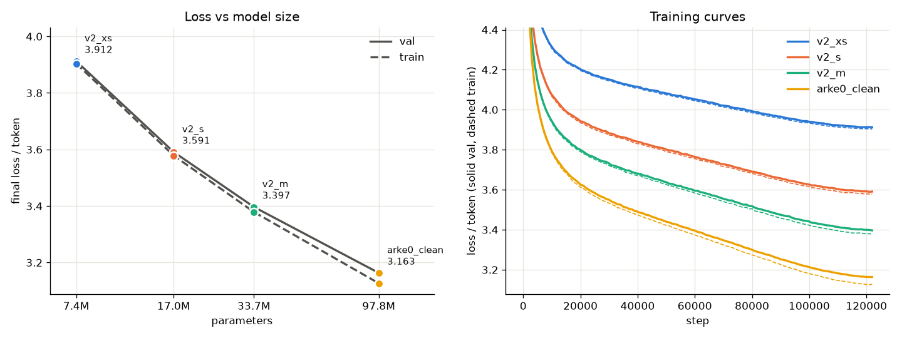

# Arke

A bilingual (Turkish–English) language model built from scratch.

*Arke comes from the Greek* arkhe*, "first principle": the starting point of everything. Fitting for a model built from first principles, from the tokenizer up.*

Part of the Arke family, alongside [Arke Code](https://github.com/makdogan2/arke-code), a local coding assistant. (This project was previously called UMAY.)

## Arke-0

A small GPT — a hand-written transformer, built for learning.

- Byte-level BPE tokenizer, vocab 8192, trained on the mixed corpus (`<|endoftext|>` separates documents)
- 6 layers, 6 heads, 384 embedding dim, 256-token context
- 13.88M parameters
- Data: mixed Turkish + English Wikipedia (~120 MB TR + ~80 MB EN), shuffled at document level
- Training: AdamW, linear warmup + cosine decay, bf16 autocast, gradient clipping

## arke0_web

The same architecture, scaled up and trained on the new web corpus (see Data).

- Byte-level BPE tokenizer, vocab 16384, trained on a 50/50 TR/EN sample
- 12 layers, 12 heads, 768 embedding dim, 256-token context, no dropout
- 97.8M parameters (85.0M without embeddings)
- Training: 122,000 steps × 64 × 256 = 2.0B tokens (1.87 epochs of the 1.07B-token corpus,
  ~20 tokens per parameter), 5 h 47 min on one RTX 5070 Ti at 103k tokens/s, in several sessions

## arke0_clean (current model)

arke0_web's exact recipe, trained again on the same corpus with its whitespace normalized
(`data/v2`, see [Whitespace cleaning](#whitespace-cleaning)). Only the data differs: same
architecture, tokenizer, steps and schedule. 5 h 57 min at 95–100k tokens/s, in two sessions.

## Setup

```
uv venv --python 3.12
uv pip install torch --index-url https://download.pytorch.org/whl/cu128
uv pip install tokenizers datasets huggingface_hub pyarrow tqdm numpy matplotlib regex
uv pip install "triton-windows>=3.7,<3.8"   # Windows only, for torch.compile (torch 2.11 -> Triton 3.7)
```

On Windows, if the PowerShell execution policy blocks `.venv\Scripts\activate`, skip activation and
call the venv interpreter directly, as in the commands below.

## Data

`data_prep.py` builds a ~4.4 GB corpus, about 50% Turkish and 50% English by bytes:

| Source | Language | License | Used |
|---|---|---|---|
| [Wikipedia](https://huggingface.co/datasets/wikimedia/wikipedia) (20231101) | TR + EN | CC BY-SA 3.0 + GFDL | ~200 MB, from `data_download.py` |
| [FineWeb2-HQ](https://huggingface.co/datasets/epfml/FineWeb2-HQ) `tur_Latn` | TR | ODC-By 1.0 | ~2.1 GB after filtering |
| [FineWeb-Edu](https://huggingface.co/datasets/HuggingFaceFW/fineweb-edu) `sample-10BT` | EN | ODC-By 1.0 | ~2.1 GB after filtering |

The FineWeb datasets are built from Common Crawl and are also subject to its terms of use.

Steps: download parquet files, clean and filter every document (`textclean.py`: template leftovers,
reference sections, date-list pages, pages under 500 characters, repetitive pages with the
Gopher duplicate-line thresholds, whitespace normalized), drop exact duplicates, train a byte-level BPE tokenizer
(vocab 16384) on a 50/50 TR/EN sample, tokenize, and send 1% of the documents to validation.
Work is saved in small shards, so after a crash the same command continues where it stopped.

## Usage

```
.venv\Scripts\python.exe data_download.py           # Wikipedia -> data/mix.txt (--force to rebuild)
.venv\Scripts\python.exe data_prep.py               # -> data/train.bin, val.bin, meta.json, bpe_16384.json
.venv\Scripts\python.exe train.py --name arke1      # train -> arke1.pt (best val), arke1_last.pt, runs/arke1.json
.venv\Scripts\python.exe train.py --name arke1 --resume   # continue an interrupted run
.venv\Scripts\python.exe sample.py --name arke1     # generate text from the checkpoint
.venv\Scripts\python.exe -m unittest test_clean     # tests for the cleaning rules
.venv\Scripts\python.exe quantize.py --scheme asym  # fake quantization at 16/8/4/2 bits -> loss table
.venv\Scripts\python.exe quantize.py --scheme asym --bits 16 4 --packed --save arke0_web_q4.pt
.venv\Scripts\python.exe quantize.py --load arke0_web_q4.pt   # measure the 4-bit file alone
.venv\Scripts\python.exe quantize.py --name arke0_clean_last --bits 16 --data data/v2   # full val loss
.venv\Scripts\python.exe sample_stats.py            # cleaned-away whitespace and repetition, in 500 samples per model
.venv\Scripts\python.exe plot_scaling.py            # model size experiment from runs/ -> docs/scaling.png
```

- `quantize.py` options:
  - `--name` picks the checkpoint (default `arke0_web_last`, the model the quantization results are for).
  - `--data` picks the folder with the validation sets (default `data`). It stops if the model's
    tokenizer differs from the one the data was tokenized with.
  - `--embedding` also quantizes the token embedding.
  - `--sample` generates text instead of measuring the loss.

- `data_prep.py --smoke` runs the whole pipeline on ~20 MB per source into `data/prep_smoke/`
  in a few minutes; progress goes to `logs/data_prep.log`.
- `train.py` options: model size (`--n_layer --n_embd --n_head`), `--data <folder>`, `--max-iters`,
  `--eval-every`, `--save-every`, `--seed`, `--no-compile`.
- `sample.py --seed` picks the random draws (default 1337; the same command gives the same text).
- `sample_stats.py --prompts "text" ...` starts the samples from text instead of `<|endoftext|>`;
  `--temperature` and `--top_k` change the sampling (defaults 0.8 and 50).
- A checkpoint stores the model config, optimizer state, schedule, data folder and random number
  generator states: `sample.py` rebuilds the exact architecture, and `--resume` continues with the
  same training batches as an uninterrupted run. The losses match only closely, not exactly: GPU
  kernels are not bit-exact, so even two uninterrupted runs differ by ~0.0001 after 100 steps, and the
  gap can grow to ~0.008 around the learning-rate peak before it shrinks again.

Arke-0 below was trained with the earlier pipeline (`data_download.py` -> `tokenizer_bpe.py` ->
`data/bpe.pt`, vocab 8192), which the current `train.py` no longer reads.

## Results

| Model | Data | Params | Steps | Train time | Val loss | ≈ per char |
|---|---|---|---|---|---|---|
| Arke-0 (char) | raw | ~10.8M | 5000 | ~3 min | 1.31 / char | 1.31 |
| Arke-0 (BPE) | raw | 13.88M | 8000 | — | 3.697 / token | 1.107 |
| Arke-0 (BPE) | cleaned | 13.88M | 8000 | 5 min 45 s | 3.718 / token | 1.100 |
| arke0_web | web + Wikipedia | 97.8M | 122,000 | 5 h 47 min | 3.161 / token | TR 0.820, EN 0.792 |
| arke0_clean | same, whitespace normalized | 97.8M | 122,000 | 5 h 57 min | 3.159 / token | TR 0.820, EN 0.791 |

Train time is the training loop on an RTX 5070 Ti (bf16, batch 64). The Arke-0 rows saw 131M
tokens (2.6 epochs of Wikipedia only), arke0_web and arke0_clean 2.0B tokens. arke0_clean is
scored on the cleaned validation set; arke0_web on it: 3.161 as well (see Whitespace cleaning).

On the cleaned corpus (190.3M characters) the BPE tokenizer produces 56.38M tokens, 3.38
characters/token (raw corpus: 56.9M tokens, 3.34). Val loss per token is not comparable across
tokenizers, so the last column divides it by characters/token. The BPE models beat the
character-level one; cleaning barely moves the loss (the validation splits also differ), but it
removed template junk such as `Ankara (; , ;` from the generated text.

### arke0_web vs Arke-0 on the same text

The per-char numbers in the table above come from different validation sets (Arke-0: Wikipedia,
arke0_web: web text), so they cannot be compared directly. Here both models read the same
characters, each through its own tokenizer, scored over every 256-token window:

| Text | Arke-0 (13.9M) | arke0_web (97.8M) | Change |
|---|---|---|---|
| Wikipedia, unseen by both models (32 articles, 0.2M chars) | 1.110 / char | **0.854 / char** | −23% |
| Web TR (`val_tr.bin`, 19.4M chars) | 1.265 / char | **0.820 / char** | −35% |
| Web EN (`val_en.bin`, 20.8M chars) | 1.233 / char | **0.792 / char** | −36% |

The Wikipedia row is the fair comparison: both models trained on Wikipedia and neither saw these
articles (they are in both validation splits). Part of the gap on web text is domain: Arke-0 never
saw web pages and scores 0.12–0.15 worse there than on Wikipedia. The comparison does not
separate the causes: arke0_web is 7× larger, saw 15× more tokens, and has a different tokenizer
and corpus.

Training curve: validation loss kept falling until the end, also in the second epoch. The gap
between train and val loss grew from ~0.02 to ~0.03, a mild sign of memorization that did not
hurt val loss. The in-training eval samples 50 random batches and moves by ±0.008 between evals,
which is more than the late-training improvement (~0.002 per 1000 steps), so `arke0_web.pt`
(the "best" checkpoint, step 118k) is a noisy pick: on the full validation set the last
checkpoint (step 122k) is slightly better, 3.1606 vs 3.1636. `train.py` now scores the same 3,200 evenly spaced
windows at every eval: on these two checkpoints random windows ranked them right in 67% of pairs,
fixed windows in 100%.

Samples: Turkish and English grammar is good (suffixes such as *değiştirilmiştir*, *anılmaktadır*
are correct) and a paragraph stays on topic, but facts are invented, phrases repeat, and the model
sometimes drifts into runs of spaces and line breaks. These most likely came from the Wikipedia
part of the corpus, which still had 614 double spaces per million characters after cleaning
(web text: 0–5), and prompts ending in a space made them far more common. arke0_clean fixes this
(next section).

### Whitespace cleaning

`textclean.normalize_whitespace` is now the last cleaning step. It removes zero-width characters,
turns tabs, non-breaking spaces and other Unicode spaces into one plain space, strips spaces at the
start and end of lines, and keeps at most one empty line in a row. In a sample of 1M characters,
Wikipedia had 1,303 lines starting with a space (43% of articles, left over from removed list
markers), 676 ending with one and 348 double spaces; the web text had almost none. After the
rule, every pattern is at 0 per million characters. The data was tokenized with the same
tokenizer, so the old model can be scored on the new validation set and only the data changes.

| Model | Trained on | Full val (cleaned) | TR / char | EN / char | Samples with cleaned-away whitespace | Longest whitespace run |
|---|---|---|---|---|---|---|
| arke0_web | original data | 3.1612 | 0.8204 | 0.7918 | 9 / 500 (1.8%) | 45 characters |
| arke0_clean | cleaned data | 3.1593 | 0.8202 | 0.7912 | **0 / 500** | 2 (`\n\n`) |

- **The loss does not move.** −0.0019 is less than the gap between two checkpoints of one run
  (118k vs 122k: 0.0030) and than the seed-to-seed spread measured on v2_xs (std ≈ 0.0025, see
  [Model size](#model-size)). Whitespace is a small part of the text, and the cleaned validation set no
  longer contains the runs the old model was trained to predict.
- **The generated text does change.** `sample_stats.py` generates 500 samples of 256 tokens per
  model, starting from `<|endoftext|>` with no prompt (temperature 0.8, top-k 50, same seeds). A
  sample counts if `normalize_whitespace` would change any of its documents. arke0_web writes such
  whitespace in 9 samples, one of them a 45-character loop of `" \n"`, the removed-list-marker
  pattern from Wikipedia. arke0_clean writes none. If both models did it equally often, all 9 would
  land on one model with probability (1/2)^9 ≈ 0.002.
- **The check itself:** on the first 2M validation tokens, the rule flags 282 of 2,284 original
  documents (12.3%) and 0 of 2,290 cleaned ones.
- **Prompts that end in a space made the old model far worse.** A prompt like `"Türkiye, "` leaves
  a lone space token at the end, which is rare before a letter but common before more whitespace
  in the old data. With the old `sample.py` prompts, half of arke0_web's samples had the pattern:

  | How a sample starts (500 samples, 3 of 4 prompts Turkish) | arke0_web: with pattern | loop (8+) | longest run | arke0_clean: with pattern | loop (8+) | longest run |
  |---|---|---|---|---|---|---|
  | no prompt | 1.8% | 0.2% | 45 | 0.0% | 0.0% | 2 |
  | prompts ending in a space | **48.0%** | 2.6% | 257 | 0.0% | 0.0% | 2 |
  | the same prompts, no space at the end | 9.4% | 0.0% | 4 | 0.2% | 0.0% | 2 |

  `sample.py` no longer ends its prompts with a space. `quantize.py --sample` keeps them, because the
  text comparisons in the Quantization section were made with those prompts.

### Repetition

Grammar was the easy part; samples often repeat themselves. `sample_stats.py` measures it on words:
**seq-rep-4** is the share of a document's word 4-grams that already appeared in it
([Welleck et al. 2019](https://arxiv.org/abs/1908.04319), eq. 10, there on tokens), and a **word loop**
is one word three or more times in a row. Real text repeats a little too, so evenly spaced validation
windows of the same length are scored as a reference. 500 samples of 256 tokens, no prompt,
temperature 0.8, top-k 50 (± is the standard error):

| Text | Params | seq-rep-4 | Samples with a word loop |
|---|---|---|---|
| real validation text | – | 0.8% ±0.1 | 0.4% ±0.3 |
| v2_xs | 7.42M | 18.4% ±1.1 | 18.6% ±1.7 |
| v2_s | 17.03M | 17.6% ±1.0 | 9.8% ±1.3 |
| v2_m | 33.72M | 12.9% ±0.8 | 6.4% ±1.1 |
| arke0_clean | 97.8M | 11.9% ±0.8 | 5.4% ±1.0 |
| arke0_web | 97.8M | 10.2% ±0.7 | 3.2% ±0.8 |

Repetition falls as the model grows, but the seq-rep-4 of even the largest models is more than 10×
that of real text. The difference between arke0_clean and arke0_web is under two standard errors on
both measures, so the cleaning did not measurably change it.

**Most of it comes from the sampling settings.** The same arke0_clean, 500 samples per setting,
same seeds:

| Temperature | top-k | seq-rep-4 | Samples with a word loop |
|---|---|---|---|
| 0.6 | 50 | 44.3% ±1.2 | 8.6% ±1.3 |
| 0.8 | 10 | 23.9% ±1.0 | 6.8% ±1.1 |
| 0.8 | 50 | 11.9% ±0.8 | 5.4% ±1.0 |
| 0.8 | 200 | 6.1% ±0.5 | 4.4% ±0.9 |
| 1.0 | 50 | 1.5% ±0.2 | 3.2% ±0.8 |

Sampling closer to the most likely token (lower temperature, smaller k) multiplies the repetition,
as [Holtzman et al. 2019](https://arxiv.org/abs/1904.09751) describe for decoding that maximizes
likelihood. At temperature 1.0 seq-rep-4 is close to real text (0.8%), but word loops are still 8×
more common, and in the four samples per setting we read, the text holds together worse: more
invented names, dates and lists. These numbers do not measure that, so no setting is called best
yet, and the defaults stay at 0.8 and 50.

### Model size

How much does a bigger model help when the data and the training budget stay the same? Three
smaller models were trained on `data/v2` with arke0_clean's recipe: same tokenizer, 122,000 steps ×
64 × 256 = 2.0B tokens, same learning-rate schedule, no dropout. Only the layers, heads and
embedding size change; arke0_clean is the largest point.



| Model | Layers / heads / dim | Params | Without embeddings | Tokens per param | Train time | Full val | TR / char | EN / char | Val gain per doubling of params |
|---|---|---|---|---|---|---|---|---|---|
| v2_xs | 4 / 4 / 256 | 7.42M | 3.16M | 270 | 57 min | 3.9085 | 1.0184 | 0.9740 | – |
| v2_s | 6 / 6 / 384 | 17.03M | 10.64M | 117 | 1 h 47 min | 3.5872 | 0.9330 | 0.8959 | 0.268 |
| v2_m | 8 / 8 / 512 | 33.72M | 25.20M | 59 | 2 h 11 min | 3.3937 | 0.8818 | 0.8488 | 0.196 |
| arke0_clean | 12 / 12 / 768 | 97.8M | 85.02M | 20 | 5 h 57 min | 3.1593 | 0.8202 | 0.7912 | 0.153 |

The table is the full validation set, measured with `quantize.py`. The plot uses the 3,200-window
eval from training, which reads 0.003–0.004 higher.

- **Bigger is still better, by less each time.** Each doubling of the parameters lowers the loss by
  0.268, then 0.196, then 0.153. Counting only the parameters outside the embedding, the same
  trend holds: 0.183, 0.156, 0.134. The largest model wins even with 20 tokens per parameter, while
  the smallest gets 270.
- **Memorization grows with size but stays small.** The gap between val and train loss at the last
  eval is 0.009, 0.013, 0.018 and 0.037.
- **Both languages improve together.** Turkish costs more per character than English in every model:
  4.6% more for v2_xs and 3.7% more for arke0_clean.
- **Run-to-run noise is small next to the size effect.** v2_xs was trained three times, changing
  only the seed (initial weights and batches): 3.9085, 3.9042 and 3.9041 on the full validation
  set, a standard deviation of about 0.0025. The steps between sizes are at least 0.19.
- **What this does not show:** the noise was measured only at the smallest size, with three runs.
  Four points do not say where the curve flattens. Train times are rough: v2_xs took 57 min during
  the night and 38–41 min in the afternoon.

To repeat one size, then redraw the figure:

```
.venv\Scripts\python.exe train.py --name v2_m --data data/v2 --n_layer 8 --n_embd 512 --n_head 8 --dropout 0 --max-iters 122000 --eval-every 1000 --save-every 1000
.venv\Scripts\python.exe plot_scaling.py
```

## Quantization

`quantize.py` makes `arke0_web_last.pt` smaller with code written from scratch, without a
quantization library. (All numbers in this section are for arke0_web, measured before
arke0_clean existed.) It splits the weights into groups of 64, gives each group its own scale, and
rounds every weight to an integer. The loss is measured on the full validation sets: every 256-token
window is scored, so random sampling adds no noise.

Only the linear weights of the 12 blocks are quantized. That is 84.9M of the 97.8M parameters
(86.8%). The token embedding, LayerNorms and biases stay bf16.

There are two schemes:
- **sym (absmax):** each group maps to −qmax … +qmax with one fp16 scale.
- **asym (min-max):** each group maps its [min, max] onto 0 … 2^bits − 1. It stores an fp16 scale and
  an fp16 minimum, which costs 0.25 bit/weight more at group size 64.

| Bits | sym bit/weight | sym val | asym bit/weight | asym val | asym TR / char | asym EN / char | asym size |
|---|---|---|---|---|---|---|---|
| 16 (bf16) | 16 | 3.1606 | 16 | 3.1606 | 0.8203 | 0.7916 | 195.6 MB |
| 8 | 8.25 | 3.1607 | 8.50 | 3.1607 | 0.8204 | 0.7916 | 116.0 MB |
| 4 | 4.25 | 3.1956 | 4.50 | **3.1846** | 0.8268 | 0.7973 | **73.5 MB** |
| 2 | 2.25 | 9.49 | 2.50 | 4.58 | 1.2046 | 1.1305 | 52.3 MB |

The val columns are loss per token. Sizes include the scales, the minimums and the bf16 parts.

- **8 bits loses nothing measurable:** the loss rises by 0.0001.
- **4 bits:** the loss rises by 0.024 with asym and 0.035 with sym. Part of asym's advantage comes
  from storing more numbers per group. With groups of 32, sym also costs 4.50 bit/weight, and it
  reaches +0.0276. So of the 0.0110 gap between sym and asym at group 64, about 0.0074 comes from
  the smaller groups and only 0.0036 from the scheme.
- **2 bits sym collapses:** val 9.49, close to random guessing (ln 16384 = 9.70). With `qmax = 1` the
  only levels are −1, 0 and +1, so every weight smaller than half of its group's maximum becomes 0.
  In `experiments/quant_demo.py`, 6 of 8 sample weights become 0. asym uses all four levels and
  does not collapse, but 4.58 is still a large loss: training got below it at step 2,000.
- **The embedding is far more sensitive.** With `--embedding` the embedding is quantized too: at
  4 bits the file is 55.4 MB and the loss rises by 0.052. The 12.6M embedding weights add +0.028 on
  their own, as much as the 84.9M block weights, so each embedding weight is about 8× more
  sensitive. Weight tying is the likely cause, since the same matrix is also the output layer. This
  was not tested separately.
- **At the same size, 4 bits beats 2 bits:**

  | Setup | Size | Val |
  |---|---|---|
  | 4-bit with the embedding quantized | 55.4 MB | 3.2125 |
  | 2-bit with the embedding left bf16 | 52.3 MB | 4.5801 |

- **Generated text:** `--sample` uses the same prompts and seed at every bit width, so only the
  weights differ.
  - 8 bits: three of the four texts match 16 bits word for word, and the fourth differs only in its
    last few tokens.
  - 4 bits: the texts diverge early, within the first sentence or right after it, but Turkish and
    English grammar is as good as at 16 bits.
  - 2 bits: unreadable.

### Real 4-bit packing

Fake quantization rounds the weights and turns them right back into floats, so the model in memory
does not get smaller. `--packed` does it for real with 4-bit asym:
- Two 4-bit values share one byte: element 2i goes in the low 4 bits and element 2i+1 in the high
  4 bits.
- Every group of 64 weights also stores an fp16 scale and an fp16 minimum.

Counted from the bytes of the packed tensors, this takes **4.50 bit/weight and 73.5 MB**, the same as
the formula. The val loss matches fake quantization at 3.1846. Unpacking returns the exact 4-bit
values; storing the scale and minimum in fp16 moves a weight by at most 0.0007 (1.1% of one
quantization step).

`--save` writes the packed model to one file. `--load` rebuilds the model from that file alone,
without the original checkpoint:

| File | Size on disk | Val | TR / char | EN / char |
|---|---|---|---|---|
| `arke0_web_last.pt`: training checkpoint | 1,174 MB | 3.1606 | 0.8203 | 0.7916 |
| `arke0_web_q4.pt`: 4-bit asym | **73.6 MB** | 3.1847 | 0.8269 | 0.7973 |

The checkpoint is 16× larger, but 782 MB of it is the AdamW state that resuming training needs. The
fp32 weights are another 391 MB. Measured against bf16 weights alone (195.6 MB), the 4-bit file is
2.7× smaller.

On disk the file holds:
- the config, tokenizer name and group size
- 48 packed matrices
- 76 bf16 tensors
- 66 KB of pickle and zip overhead (0.09%)

The tied embedding is written once. Loading from the file adds 0.0001 to the loss, because the parts
that are not quantized are stored as bf16.

Every script opens `.pt` files with `torch.load(..., weights_only=True)`. In this mode only
tensors, dicts, lists, numbers and strings can come out of a file, so opening a downloaded file
cannot run code.

## Repository layout

```
data_download.py   Wikipedia download -> data/mix.txt
data_prep.py       resumable data pipeline: download, clean, dedup, tokenizer, train/val .bin
textclean.py       cleaning and filtering rules shared by the data scripts
test_clean.py      tests for textclean.py
model.py           Config dataclass + transformer (Arke0)
train.py           training loop: memmap data, torch.compile, checkpoints + resume
sample.py          text generation
quantize.py        quantization from scratch: 8/4/2-bit loss table, 4-bit packing, --save / --load
sample_stats.py    counts cleaned-away whitespace and repetition in generated samples, compares checkpoints
plot_scaling.py    plots the model size experiment from the runs/<name>.json logs
docs/scaling.png   the figure plot_scaling.py draws, shown in Model size
count_junk.py      measures leftover junk (CSS, category lines, references) in the corpus
tokenizer_bpe.py   earlier pipeline: BPE tokenizer + data/bpe.pt (vocab 8192)
experiments/       learning-phase scripts: char tokenizer, BPE from scratch, attention, quantization and packing demos
```

## Roadmap

- [x] Arke-0 — character-level, from scratch
- [x] BPE tokenizer
  - [x] Merge algorithm from scratch (2.43x compression at 1k merges)
  - [x] Byte-level BPE, vocab 8192, trained on the mixed corpus
- [x] LR schedule (warmup + cosine), bf16 autocast
- [x] Data cleaning: template leftovers, list pages, document separators
- [x] `torch.compile` + fused AdamW: 207k -> 251k tokens/s on a 33.7M model
- [x] Checkpoints with exact resume
- [x] Data pipeline: FineWeb2-HQ TR + FineWeb-Edu EN, dedup, 50/50 TR/EN tokenizer (vocab 16384)
- [x] Scaling: arke0_web, 97.8M parameters trained on the new ~4.4 GB corpus (2.0B tokens)
- [x] Quantization from scratch: 8, 4 and 2-bit weights
  - [x] Real 4-bit packing and a standalone file: 1,174 MB checkpoint -> 73.6 MB, val +0.024
- [x] Whitespace cleaning: arke0_clean, same loss, no more whitespace loops (0/500 samples vs 9/500)
- [x] Model size experiment: 7.4M to 97.8M on the same 2.0B tokens, val 3.909 -> 3.159
- [ ] Arke-1 — a conversational assistant with tool use
